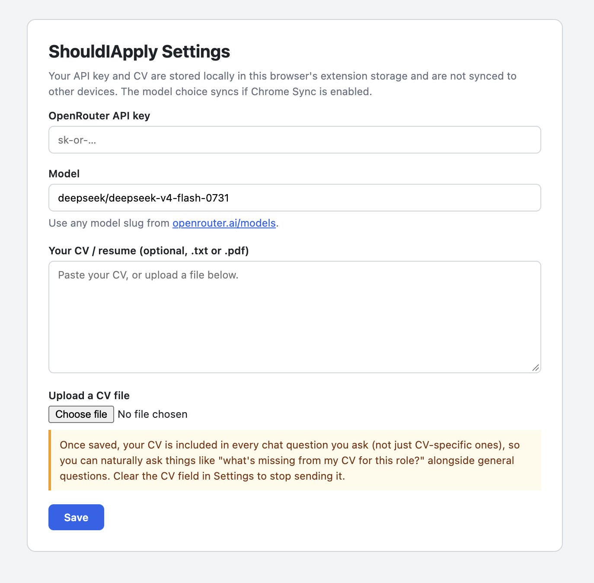

# ShouldIApply

A Manifest V3 Chrome extension that answers the question job seekers
actually have when they land on a posting: should I bother applying?

On job pages, the floating panel shows evidenced blockers first, followed by
a skills estimate, separate hard/soft skill findings, and placement suitability
when enabled. Expand evidence and clarify experience without editing your CV.

## Setup

1. chrome://extensions  -  Developer mode - Load unpacked - select this folder
2. Options: add an OpenRouter API key and your CV (.txt / .pdf, or paste)

## Settings

Configure your OpenRouter API key, choose a model, and add your CV in the extension settings.



## Behavior

- Job page + CV saved: a skills estimate with separate hard/soft skill groups, direct/partial/transferable evidence, and gaps to clarify
- Expand a finding to see job-posting and CV quotes. Quotes are checked against the supplied text and kept in their original language.
- Distinguish “Not evidenced in CV” from “Confirmed gap.” Missing information alone does not prove that you lack a skill.
- Add relevant experience or confirm “I need to learn this,” then reassess. Clarifications are stored locally for that posting and CV version, are included in subsequent AI assessments and follow-up questions, and can be removed. They do not edit your original CV.
- Job page + no CV: prompt to add your CV first
- Generic page: plain summary (unchanged summarizer)
- AI responses follow the article or job posting’s language, including CV comparisons and follow-up answers (for example, Nepali content produces Nepali responses).
- Fit re-runs automatically whenever the saved CV changes (cached per URL + CV fingerprint)

## Placement assessment

Enable **My placement requirements** in Settings, enter or import your profile, and click **Save**. Dates, duration, weekly hours and project relevance are assessed separately from skills. Fixed, evidenced conflicts appear first; unspecified flexibility and missing information produce clarification questions. Unconfirmed hours and an unknown academic return deadline are never silently treated as fixed constraints.

Profiles are stored in local extension storage and included in job assessments and job follow-up questions when enabled. Updating the profile invalidates saved assessments; refresh or reopen the panel to regenerate them. Personal dates are not built into the source code. Assessment results support your decision; confirm academic suitability with your university.

## Build notes

No build step. Vendored libs live in lib/ (readability.js, pdf.js).

## Checks

```bash
node --test tests/*.test.cjs
python3 test_fit_logic.py
```

The JavaScript tests exercise the real assessment handlers with mocked Chrome and AI responses; they do not measure a live model's accuracy.
