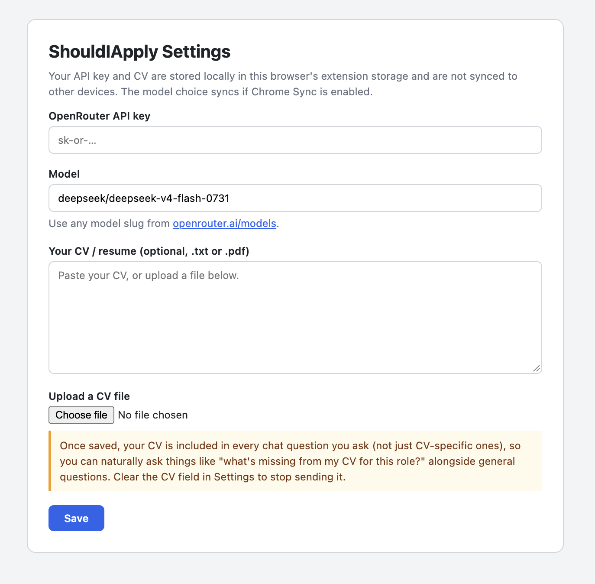

# ShouldIApply

A Manifest V3 Chrome extension that answers the question job seekers
actually have when they land on a posting: should I bother applying?

On job pages, the floating panel shows a fit verdict first: a score, a
Strong / Partial / Weak band, why you did or did not match, and the key
gaps against your saved CV.

## Setup

1. chrome://extensions  -  Developer mode - Load unpacked - select this folder
2. Options: add an OpenRouter API key and your CV (.txt / .pdf, or paste)

## Settings

Configure your OpenRouter API key, choose a model, and add your CV in the extension settings.

## Behavior

- Job page + CV saved: fit-first verdict (score, band, why, gaps)
- Job page + no CV: prompt to add your CV first
- Generic page: plain summary (unchanged summarizer)
- Fit re-runs automatically whenever the saved CV changes (cached per URL + CV fingerprint)

## Build notes

No build step. Vendored libs live in lib/ (readability.js, pdf.js).
